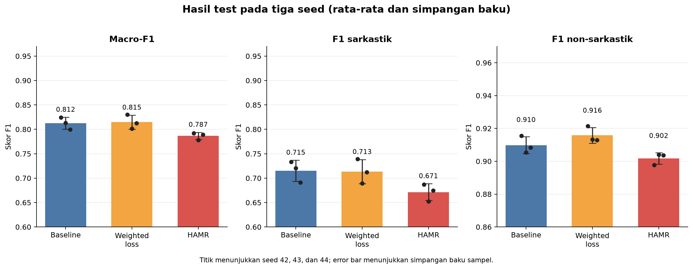

# Laporan Eksperimen HAMR pada Twitter Indonesia

**Tanggal laporan:** 14 Oktober 2026  
**Notebook sumber:** [`notebooks/colab_hamr_twitter.ipynb`](../../notebooks/colab_hamr_twitter.ipynb)  
**Status:** seluruh sembilan run selesai dan ringkasan hasil berhasil dibuat.

## Ringkasan

Eksperimen membandingkan baseline IndoBERT Base, weighted loss, dan HAMR pada dataset Twitter Indonesia dengan seed 42, 43, dan 44. Semua run memakai train core yang sama dan pemilihan checkpoint berdasarkan macro-F1 validation. HAMR menggunakan meta-set terpisah dari train.

HAMR tidak meningkatkan hasil pada konfigurasi awal ini. Rata-rata macro-F1 test HAMR adalah **0,7865**, dibanding **0,8124** untuk baseline dan **0,8146** untuk weighted loss. Rata-rata F1 kelas sarkastik (binary F1) HAMR juga lebih rendah: **0,6713**, dibanding **0,7151** (baseline) dan **0,7134** (weighted loss), serta berada di bawah acuan paper IndoBERT (**0,7273**) maupun hasil replikasi IndoBERT pada train penuh (**0,7611** pada seed 42). Weighted loss memperoleh macro-F1 rata-rata tertinggi, tetapi selisihnya terhadap baseline hanya **0,0022**.

## Konfigurasi dan data

| Komponen | Pengaturan yang digunakan |
|---|---|
| Dataset | `w11wo/twitter_indonesia_sarcastic` |
| Model klasifikasi | `indobenchmark/indobert-base-p1` |
| Runtime | Google Colab, Tesla T4, VRAM 14,6 GiB |
| Panjang maksimum | 128 token |
| Batch training / akumulasi gradien | 8 / 4 (effective batch 32) |
| Learning rate | `1e-5` |
| Maksimum epoch | 20, evaluasi setiap epoch |
| Early stopping | Patience 3, threshold 0,01 |
| Seed | 42, 43, 44 |
| Encoder embedding KNN | `paraphrase-multilingual-MiniLM-L12-v2`, embedding 384 dimensi |
| Label positif | `1` = sarkastik |

| Split | Jumlah | Sarkastik (1) | Non-sarkastik (0) |
|---|---:|---:|---:|
| Train core | 1.690 | 423 | 1.267 |
| Meta HAMR | 94 | 47 | 47 |
| Validation | 268 | 67 | 201 |
| Test | 538 | 134 | 404 |

Meta-set diambil secara stratified dari train lalu diseimbangkan; seluruh barisnya dikeluarkan dari train core. Validation tetap dipakai untuk evaluasi epoch, early stopping, dan pemilihan checkpoint. Test tidak dipakai untuk meta-update atau pemilihan checkpoint; prediksi test dijalankan sesudah training untuk evaluasi akhir tiap model dan seed.

## Hasil per seed

Nilai pada tabel adalah metrik test. Confusion matrix memakai urutan label `[0, 1]`, sehingga susunannya adalah `[[TN, FP], [FN, TP]]`. Metrik **F1 sarkastik** adalah binary F1 pada kelas positif (`1` = sarkastik), yang setara dengan metrik F1 pada laporan replikasi IdSarcasm.

| Metode | Seed | Accuracy | Macro-F1 | F1 sarkastik | Precision sarkastik | Recall sarkastik | F1 non-sarkastik | Confusion matrix |
|---|---:|---:|---:|---:|---:|---:|---:|---|
| Baseline | 42 | 0,8717 | 0,8246 | 0,7336 | 0,7600 | 0,7090 | 0,9155 | `[[374, 30], [39, 95]]` |
| Weighted loss | 42 | 0,8792 | 0,8302 | 0,7390 | 0,8000 | 0,6866 | 0,9214 | `[[381, 23], [42, 92]]` |
| HAMR | 42 | 0,8457 | 0,7922 | 0,6868 | 0,6947 | 0,6791 | 0,8977 | `[[364, 40], [43, 91]]` |
| Baseline | 43 | 0,8587 | 0,8130 | 0,7206 | 0,7101 | 0,7313 | 0,9055 | `[[364, 40], [36, 98]]` |
| Weighted loss | 43 | 0,8643 | 0,8013 | 0,6894 | 0,8020 | 0,6045 | 0,9132 | `[[384, 20], [53, 81]]` |
| HAMR | 43 | 0,8494 | 0,7781 | 0,6524 | 0,7677 | 0,5672 | 0,9039 | `[[381, 23], [58, 76]]` |
| Baseline | 44 | 0,8587 | 0,7997 | 0,6911 | 0,7589 | 0,6343 | 0,9084 | `[[377, 27], [49, 85]]` |
| Weighted loss | 44 | 0,8662 | 0,8124 | 0,7120 | 0,7672 | 0,6642 | 0,9128 | `[[377, 27], [45, 89]]` |
| HAMR | 44 | 0,8513 | 0,7892 | 0,6748 | 0,7411 | 0,6194 | 0,9036 | `[[375, 29], [51, 83]]` |

## Rata-rata dan variasi antar-seed

Simpangan baku adalah simpangan baku sampel dari tiga seed. Angka ini mendeskripsikan variasi run dan bukan interval kepercayaan.

| Metode | Accuracy (mean ± SD) | Macro-F1 (mean ± SD) | F1 sarkastik (mean ± SD) | Precision sarkastik (mean ± SD) | Recall sarkastik (mean ± SD) | F1 non-sarkastik (mean ± SD) |
|---|---:|---:|---:|---:|---:|---:|
| Baseline | 0,8631 ± 0,0075 | 0,8124 ± 0,0124 | **0,7151 ± 0,0218** | 0,7430 ± 0,0285 | **0,6915 ± 0,0508** | 0,9098 ± 0,0052 |
| Weighted loss | **0,8699 ± 0,0081** | **0,8146 ± 0,0146** | 0,7134 ± 0,0248 | **0,7897 ± 0,0195** | 0,6518 ± 0,0424 | **0,9158 ± 0,0048** |
| HAMR | 0,8488 ± 0,0028 | 0,7865 ± 0,0074 | 0,6713 ± 0,0175 | 0,7345 ± 0,0369 | 0,6219 ± 0,0560 | 0,9017 ± 0,0035 |

## Perbandingan dengan hasil replikasi IdSarcasm dan acuan paper

Tabel berikut menyandingkan hasil eksperimen ini dengan laporan replikasi ([`results/replication_comparison/laporan_replikasi.md`](../replication_comparison/laporan_replikasi.md)) dan checkpoint acuan paper/Hugging Face pada test set Twitter yang sama ($N = 538$). Pada laporan replikasi dan acuan paper, metrik **F1** yang dilaporkan adalah **binary F1 pada kelas positif (`1` = sarkastik)**, sehingga dibandingkan langsung dengan kolom **F1 sarkastik**.

| Sumber & cakupan seed | Model / Metode | Ukuran train | Kriteria seleksi checkpoint | Accuracy | Precision sarkastik | Recall sarkastik | **F1 sarkastik (Binary F1)** | Macro-F1 |
|---|---|---:|---|---:|---:|---:|---:|---:|
| **Acuan paper / HF** | IndoBERT Base | 1.878 | Validation F1 (binary) | 0,8662 | 0,7385 | 0,7164 | **0,7273** | - |
| **Acuan paper / HF** | XLM-R Large | 1.878 | Validation F1 (binary) | 0,8885 | 0,7937 | 0,7463 | **0,7692** | - |
| **Replikasi (seed 42)** | IndoBERT Base | 1.878 | Validation F1 (binary) | **0,8903** | **0,8319** | 0,7015 | **0,7611** | - |
| **Replikasi (seed 42)** | XLM-R Large | 1.878 | Validation F1 (binary) | 0,8662 | 0,7067 | **0,7910** | **0,7465** | - |
| **Eksperimen HAMR (seed 42)** | IndoBERT Baseline | 1.690 | Validation Macro-F1 | 0,8717 | 0,7600 | 0,7090 | **0,7336** | 0,8246 |
| **Eksperimen HAMR (seed 42)** | IndoBERT + Weighted loss | 1.690 | Validation Macro-F1 | 0,8792 | 0,8000 | 0,6866 | **0,7390** | **0,8302** |
| **Eksperimen HAMR (seed 42)** | IndoBERT + HAMR | 1.690 (+94 meta) | Validation Macro-F1 | 0,8457 | 0,6947 | 0,6791 | **0,6868** | 0,7922 |
| **Eksperimen HAMR (mean 3 seed)** | IndoBERT Baseline | 1.690 | Validation Macro-F1 | 0,8631 | 0,7430 | 0,6915 | **0,7151** | 0,8124 |
| **Eksperimen HAMR (mean 3 seed)** | IndoBERT + Weighted loss | 1.690 | Validation Macro-F1 | 0,8699 | 0,7897 | 0,6518 | **0,7134** | **0,8146** |
| **Eksperimen HAMR (mean 3 seed)** | IndoBERT + HAMR | 1.690 (+94 meta) | Validation Macro-F1 | 0,8488 | 0,7345 | 0,6219 | **0,6713** | 0,7865 |

### Catatan perbandingan dengan laporan replikasi

1. **Perbedaan IndoBERT Baseline pada seed 42 (`0,7336` vs `0,7611` di replikasi):**
   - **Ukuran data train:** Eksperimen HAMR menyisihkan sebagian sampel train untuk meta-set sehingga seluruh metode dilatih pada *train core* yang sama (1.690 sampel, berkurang 188 sampel dibanding 1.878 sampel pada replikasi penuh). Meski menggunakan data train lebih sedikit, pada seed 42 IndoBERT Baseline (`0,7336`) dan Weighted loss (`0,7390`) tetap melampaui nilai acuan paper IndoBERT (`0,7273`).
   - **Kriteria checkpoint & jadwal training:** Replikasi memilih checkpoint berdasarkan *binary F1* validation (maksimum 100 epoch, batch 32 langsung), sedangkan eksperimen ini memilih checkpoint berdasarkan *macro-F1* validation (maksimum 20 epoch, early stopping patience 3, micro-batch 8 dengan gradient accumulation 4).
2. **Posisi HAMR terhadap replikasi dan acuan:**
   - Baik pada seed 42 (`0,6868`) maupun rata-rata 3 seed (`0,6713`), F1 sarkastik HAMR berada di bawah Baseline pada *train core* yang sama (`0,7336` seed 42; `0,7151` rata-rata), di bawah replikasi IndoBERT (`0,7611`), dan di bawah acuan paper IndoBERT (`0,7273`).
3. **Efek pemilihan seed (mengonfirmasi temuan laporan replikasi):**
   - Laporan replikasi mencatat bahwa evaluasi satu seed (seed 42) rentan terhadap variasi acak pada dataset Twitter yang berukuran kecil. Hal ini terkonfirmasi pada eksperimen tiga seed ini: **seed 42 secara konsisten menghasilkan skor tertinggi** di semua metode (misalnya F1 sarkastik Baseline `0,7336` pada seed 42 turun menjadi `0,7206` pada seed 43 dan `0,6911` pada seed 44).

## Interpretasi

- **HAMR tertinggal dari baseline pada ketiga seed.** Rata-rata macro-F1 lebih rendah sekitar 0,0259 dan F1 sarkastik lebih rendah sekitar 0,0438. Jadi eksperimen ini belum mendukung klaim bahwa HAMR memperbaiki deteksi sarkasme pada data ini.
- **Weighted loss memberi hasil macro-F1 rata-rata tertinggi**, tetapi peningkatan 0,0022 terhadap baseline kecil dan tidak konsisten di semua seed: weighted loss lebih tinggi pada seed 42 dan 44, lebih rendah pada seed 43. Serupa dengan pola IndoBERT pada laporan replikasi, weighted loss cenderung meningkatkan precision (`0,7897` rata-rata) namun menurunkan recall (`0,6518` rata-rata).
- **Performa kelas minoritas tetap menjadi tantangan.** F1 sarkastik berkisar 0,6524–0,7390, sementara F1 non-sarkastik berkisar 0,8977–0,9214.
- Tiga seed memberi gambaran awal variasi eksperimen, tetapi belum cukup untuk menyatakan keunggulan statistik atau generalisasi luas.

## Pemeriksaan kesesuaian dan keterbatasan

- Smoke run HAMR selesai dengan GPU dan menghasilkan evaluasi validation; log menunjukkan waktu training sekitar 90 detik.
- Ukuran split, jumlah label, dan dimensi embedding cocok dengan rancangan notebook.
- Checkpoint dipilih memakai macro-F1 validation; HAMR menerima meta-set tersendiri dan early stopping.
- Notebook menyimpan confusion matrix test dan metrik validation. Namun, **confusion matrix validation tidak disimpan** dalam ringkasan saat ini.
- Evaluasi test sudah dilakukan untuk seluruh kombinasi metode dan seed sebagai evaluasi akhir. Gunakan validation untuk analisis atau perubahan konfigurasi berikutnya; jangan memilih konfigurasi berdasarkan hasil test ini.
- Notebook yang tersimpan memuat output eksekusi dan tabel hasil. Artefak model, log, serta prediksi lengkap berada di Google Drive pada `/content/drive/MyDrive/idsarcasm/hamr_twitter/`, bukan di folder workspace lokal.

## Kesimpulan dan langkah berikutnya

Eksperimen berjalan sampai selesai dan pipeline perbandingan berfungsi. Pada konfigurasi yang diuji, HAMR belum memberi peningkatan terhadap baseline maupun weighted loss, serta berada di bawah skor acuan paper dan hasil replikasi IndoBERT Base. Simpan hasil ini sebagai hasil evaluasi konfigurasi awal. Jika melanjutkan penelitian, gunakan validation untuk mendiagnosis HAMR—misalnya memeriksa meta-update, distribusi bobot hardness, dan kontribusi KNN—serta tetapkan perubahan sebelum eksperimen baru. Karena test saat ini sudah dipakai untuk evaluasi akhir, klaim konfirmasi atas konfigurasi baru sebaiknya diuji pada test independen.
