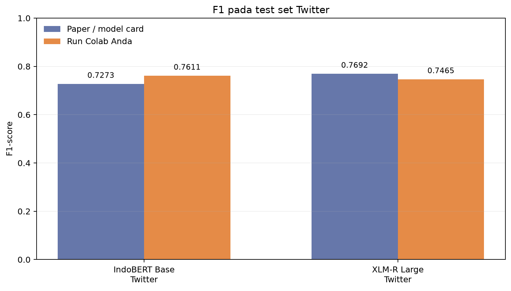
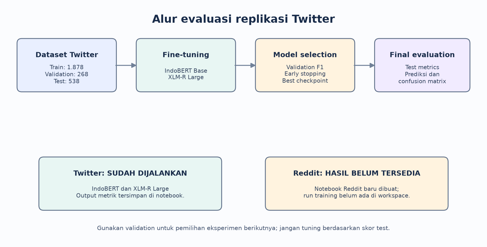
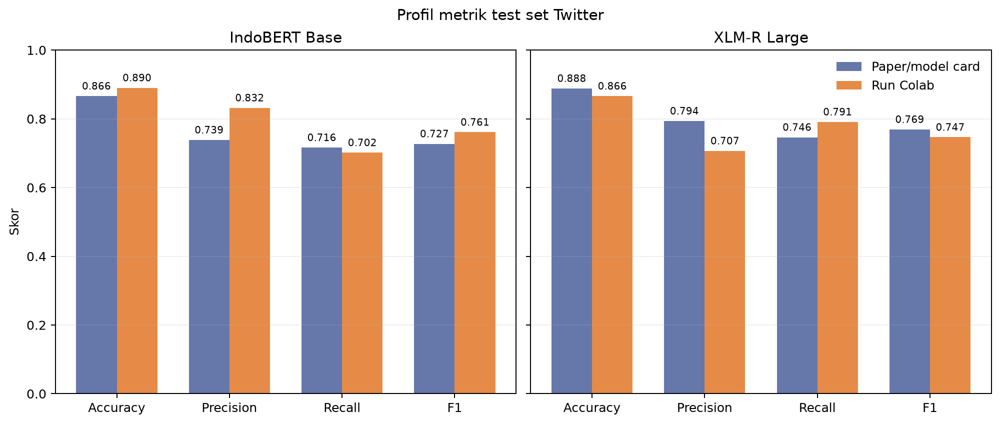

# Laporan Perbandingan Replikasi IdSarcasm

**Tanggal laporan:** 12 Oktober 2026  
**Cakupan hasil yang tersedia:** eksperimen Twitter dengan IndoBERT Base dan XLM-R Large. Notebook XLM-R Large untuk Reddit sudah tersedia, tetapi belum memiliki output training, sehingga hasil Reddit belum dapat dibandingkan.

## Ringkasan

Dua eksperimen Twitter sudah dijalankan pada split resmi dataset Hugging Face. Pada run Anda, IndoBERT Base memperoleh F1 test **0,7611**, sedangkan XLM-R Large memperoleh **0,7465**. Angka acuan yang dilaporkan paper/repo masing-masing adalah **0,7273** dan **0,7692**.

Dengan demikian, pada run yang tersedia, IndoBERT Base Anda melampaui nilai acuan sebesar **0,0338** (3,38 poin persentase), sementara XLM-R Large berada **0,0227** (2,27 poin persentase) di bawah nilai acuannya. Di antara dua run Twitter Anda, F1 IndoBERT lebih tinggi **0,0146** daripada XLM-R Large. Ini adalah perbandingan satu run/seed dan belum membuktikan perbedaan yang signifikan secara statistik.

## Dataset dan split

Notebook menggunakan dataset siap pakai dari Hugging Face. Dataset menyediakan split train, validation, dan test; notebook tidak membuat split baru.

| Dataset | Train | Validation | Test | Status eksperimen Anda |
| --- | ---: | ---: | ---: | --- |
| Twitter Indonesia Sarcastic | 1.878 | 268 | 538 | IndoBERT Base dan XLM-R Large selesai |
| Reddit Indonesia Sarcastic | 9.881 | 1.411 | 2.824 | Notebook tersedia, hasil run belum tersedia |

Komposisi split tersebut tercantum pada [kartu dataset Twitter](https://huggingface.co/datasets/w11wo/twitter_indonesia_sarcastic) dan [kartu dataset Reddit](https://huggingface.co/datasets/w11wo/reddit_indonesia_sarcastic). Split validation digunakan saat training untuk memantau F1 dan memilih checkpoint. Setelah training, script mengevaluasi split test dan menulis prediksinya.

## Hasil Twitter

Metrik run Colab diambil dari output sel visualisasi pada notebook yang sudah dijalankan. Metrik referensi diambil dari nilai evaluasi checkpoint yang dipublikasikan pada model card Hugging Face untuk IndoBERT dan XLM-R Large, serta F1 yang dilaporkan repo/paper.

| Model | Metrik | Paper / checkpoint rilis | Run Colab Anda | Selisih run - referensi |
| --- | --- | ---: | ---: | ---: |
| IndoBERT Base | Accuracy | 0,8662 | 0,8903 | +0,0241 |
| IndoBERT Base | Precision | 0,7385 | 0,8319 | +0,0934 |
| IndoBERT Base | Recall | 0,7164 | 0,7015 | -0,0149 |
| IndoBERT Base | **F1** | **0,7273** | **0,7611** | **+0,0338** |
| XLM-R Large | Accuracy | 0,8885 | 0,8662 | -0,0223 |
| XLM-R Large | Precision | 0,7937 | 0,7067 | -0,0870 |
| XLM-R Large | Recall | 0,7463 | 0,7910 | +0,0447 |
| XLM-R Large | **F1** | **0,7692** | **0,7465** | **-0,0227** |

### Interpretasi

- **IndoBERT Base:** F1 run Anda lebih tinggi daripada checkpoint acuan. Precision lebih tinggi, sementara recall sedikit lebih rendah. Artinya, pada run ini model lebih jarang memberi label sarkasme secara keliru, tetapi melewatkan sedikit lebih banyak contoh sarkasme dibanding nilai acuan.
- **XLM-R Large:** run Anda memiliki recall lebih tinggi, tetapi precision lebih rendah daripada checkpoint acuan. F1 akhirnya lebih rendah 2,27 poin persentase.
- **Model terbaik pada hasil Twitter Anda saat ini:** IndoBERT Base dengan F1 0,7611. Ini berbeda dari tabel acuan repo, yang menempatkan XLM-R Large sebagai yang terbaik dengan F1 0,7692.
- F1 dihitung dengan metrik klasifikasi biner pada script. Interpretasi precision/recall di atas menganggap label positif `1` sebagai sarkasme.

## Status perbandingan Reddit

Paper/repo melaporkan F1 XLM-R Large **0,6274** dan IndoBERT Base IndoNLU **0,6100** untuk Reddit. Notebook [XLM-R Large Reddit](../../notebooks/colab_replication_xlmr_large_reddit.ipynb) sudah dikonfigurasi memakai dataset Reddit dan kolom teks `text`, tetapi saat laporan ini dibuat notebook tersebut belum memiliki output training tersimpan. Karena itu belum ada skor replikasi Reddit untuk dibandingkan.

Jalankan notebook Reddit, lalu tambahkan metrik test (accuracy, precision, recall, F1) ke bagian ini. Jangan mengisi skor replikasi Reddit dengan nilai paper.

## Kesetaraan konfigurasi dan batasan

Kedua run Twitter memakai seed 42, panjang maksimum 128 token, learning rate `1e-5`, scheduler cosine, weight decay `0.03`, dan batas maksimum 100 epoch. Training berhenti lebih awal: IndoBERT sekitar epoch 9 dan XLM-R Large sekitar epoch 9. Nilai validation F1 terbaik yang terlihat pada log adalah sekitar 0,7786 (IndoBERT, epoch 6) dan 0,8116 (XLM-R Large, sekitar epoch 6). F1 validation ini **bukan** skor test dan tidak boleh disamakan dengannya.

Ada perbedaan implementasi yang perlu dicatat saat membandingkan dengan checkpoint publik:

- Recipe paper/repo mencantumkan batch training 32 dan batch evaluasi 64. Notebook XLM-R Large Anda memakai micro-batch 8 dengan gradient accumulation 4 (effective batch training 32), serta batch evaluasi 16 untuk menyesuaikan memori GPU Colab.
- Notebook memasang Transformers versi `4.47.1`; output XLM-R mencatat PyTorch `2.11.0+cu130` pada Tesla T4. Lingkungan dan perangkat keras ini dapat berbeda dari pelatihan checkpoint publik.
- Run hanya memakai satu seed. Variasi seed dapat mengubah hasil, terutama pada dataset Twitter yang berukuran kecil. Untuk klaim metode lebih baik, pertimbangkan beberapa seed dan laporkan rata-rata serta simpangan baku.
- Anda sudah melihat skor test dari kedua run. Hindari mengubah parameter berulang kali berdasarkan skor test tersebut. Gunakan validation untuk eksperimen berikutnya dan sisakan test untuk evaluasi final metode yang sudah ditetapkan.

Karena perbedaan perangkat, versi library, serta ukuran micro-batch, angka ini paling tepat disebut **replikasi eksperimental dengan konfigurasi yang mendekati recipe**, bukan reproduksi numerik yang identik.

## Kesimpulan sementara

Untuk dataset Twitter, hasil yang tersedia menunjukkan bahwa IndoBERT Base pada run Anda mengungguli XLM-R Large pada metrik F1 test, walaupun paper/repo melaporkan XLM-R Large sebagai model terbaik. Perbedaan ini adalah temuan awal untuk satu seed; verifikasi dengan beberapa seed diperlukan sebelum menyimpulkan IndoBERT lebih unggul secara umum.

Cakupan seluruh dataset IdSarcasm belum selesai karena Reddit belum dijalankan. Setelah eksperimen Reddit selesai, bandingkan kedua model pada test Reddit dengan prosedur yang sama. Simpan model dan checkpoint besar di Google Drive; cukup commit laporan, grafik, konfigurasi, dan metrik ringkas ke GitHub.

## Sumber

1. Suhartono, Wongso, dan Handoyo, [*IdSarcasm: Benchmarking and Evaluating Language Models for Indonesian Sarcasm Detection*](https://doi.org/10.1109/ACCESS.2024.3416955), IEEE Access, 2024.
2. Repo [w11wo/id_sarcasm](https://github.com/w11wo/id_sarcasm) — tabel skor F1 baseline untuk Reddit dan Twitter.
3. Hugging Face model card [IndoBERT Base - Twitter](https://huggingface.co/w11wo/indobert-base-p1-twitter-indonesia-sarcastic) — accuracy 0,8662, precision 0,7385, recall 0,7164, F1 0,7273.
4. Hugging Face model card [XLM-R Large - Twitter](https://huggingface.co/w11wo/xlm-roberta-large-twitter-indonesia-sarcastic) — accuracy 0,8885, precision 0,7937, recall 0,7463, F1 0,7692.
5. Kartu dataset [Twitter](https://huggingface.co/datasets/w11wo/twitter_indonesia_sarcastic) dan [Reddit](https://huggingface.co/datasets/w11wo/reddit_indonesia_sarcastic) — definisi kolom dan jumlah data per split.